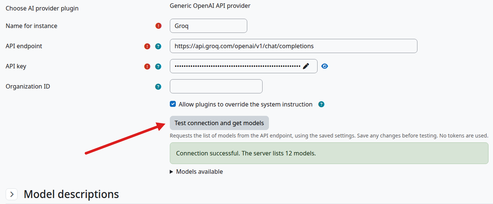

# Generic OpenAI API provider for Moodle

An AI provider for the Moodle AI subsystem that works with any server offering the OpenAI API, such as OpenAI,
Groq, Ollama, vLLM, LM Studio, OpenRouter and Together AI. It supports the generate text, summarise text,
explain text and generate image actions.

No model names are built in, as the models a service offers change over time. The AI model lists are taken from
the server's own list of models, which is refreshed every hour, so new models appear without a plugin update.
A Test connection button checks the endpoint and API key without using any tokens, and warns about actions whose
model the server does not list.

Models can optionally be described in JSON, typed in or loaded from a file, to give them display names, a default,
settings fields or image sizes. Extra request parameters such as temperature can be set for any model.

Full user documentation is in [docs/userdocs.md](docs/userdocs.md)

This plugin was written by Marcus Green

The latest source can be found at

https://github.com/marcusgreen/moodle-aiprovider_genericopenai

Place the files in a directory

moodle/public/ai/provider/genericopenai

Where moodle is the directory containing your Moodle code. Since Moodle 5.1 the web root is its public directory.

Go to Site Administration/Notifications

Then go to Site Administration/General/AI/AI providers, create a new provider instance and choose
Generic OpenAI API provider. Enter the API endpoint, for example https://api.openai.com/v1,
https://api.groq.com/openai/v1 or http://localhost:11434/v1 for Ollama, and the API key.
